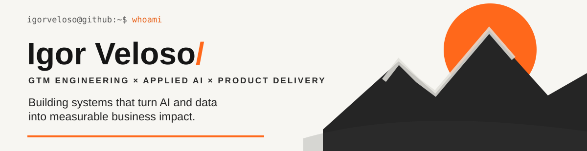
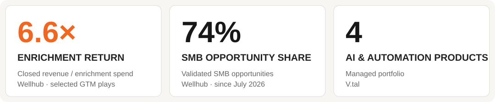
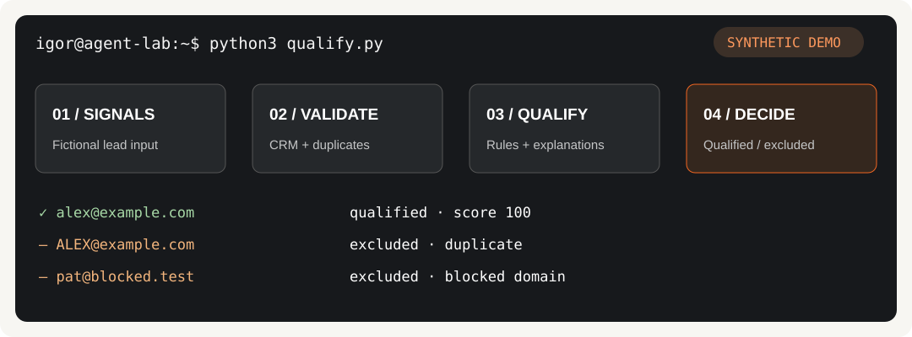
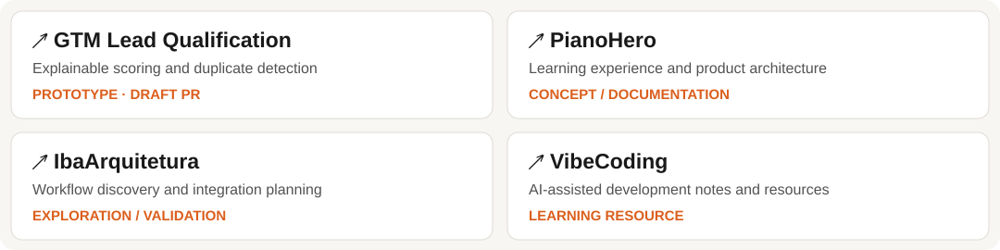
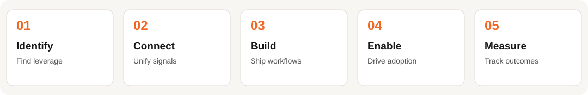
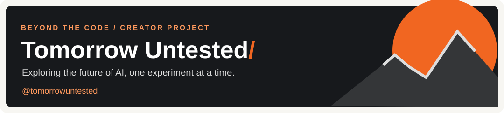
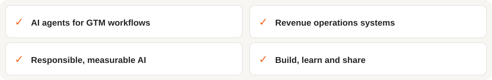

**GTM Engineer · Applied AI · Product & Operations**

[LinkedIn](https://www.linkedin.com/in/igor-veloso) · [Projects](https://github.com/igorveloso?tab=repositories) · [Tomorrow Untested ↗](https://www.youtube.com/@tomorrowuntested)

---

## / Impact at a glance

*Selected outcomes from previous work; figures are not live dashboard data. Metrics refer to different initiatives and time periods.*

## / AI Agent Command Center

**From signals to explainable decisions.**

**Prototype, not a live agent.** The current implementation uses fictional data, deterministic Python rules, and no production CRM connections. An ADK integration is planned, not yet implemented.

[Explore the GTM qualification prototype](https://github.com/igorveloso/adk-agentsamples/pull/1) · [See the upstream ADK samples](https://github.com/google/adk-samples)

## / Selected builds

**Explore:** [GTM Lead Qualification](https://github.com/igorveloso/adk-agentsamples/pull/1) · [PianoHero](https://github.com/igorveloso/PianoHero) · [IbaArquitetura](https://github.com/igorveloso/IbaArquitetura) · [VibeCoding](https://github.com/igorveloso/vibecoding)

Some other public repositories are forks, upstream examples or learning copies. I credit original maintainers and distinguish their work from my own adaptations.

## / How I work

At **Wellhub**, I work on UK outbound GTM systems using Clay, Salesforce and Salesloft, with enrichment, validation, routing and measurable commercial outcomes.

Previously at **V.tal**, I coordinated AI and automation initiatives across product discovery, technical delivery and operational adoption. At **allu**, I worked on product growth and analytics; daily active users grew from approximately 120 to 600 (**5× the original level**).

## / Beyond the code

A personal creator project exploring AI breakthroughs, emerging technologies and practical experiments.

**[Explore Tomorrow Untested on YouTube ↗](https://www.youtube.com/@tomorrowuntested)**

*An independent creator project; not affiliated with my employers.*

## / Current focus

---

**Build useful things. Measure what matters. Keep exploring.**

[LinkedIn](https://www.linkedin.com/in/igor-veloso) · [GitHub](https://github.com/igorveloso) · [Tomorrow Untested](https://www.youtube.com/@tomorrowuntested)

